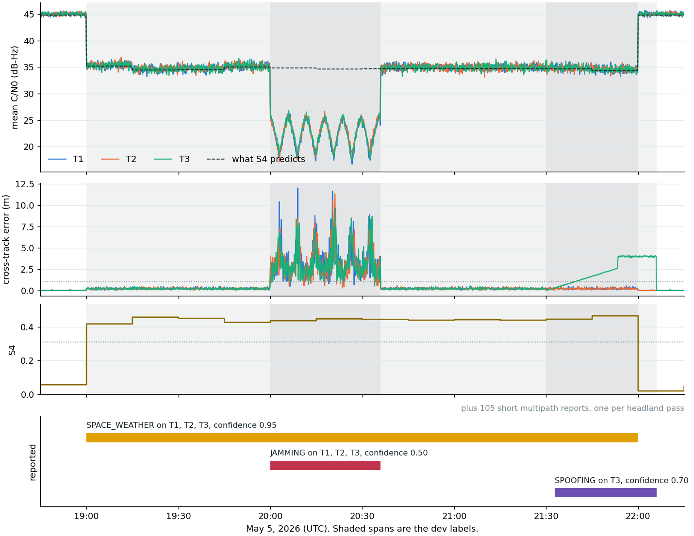
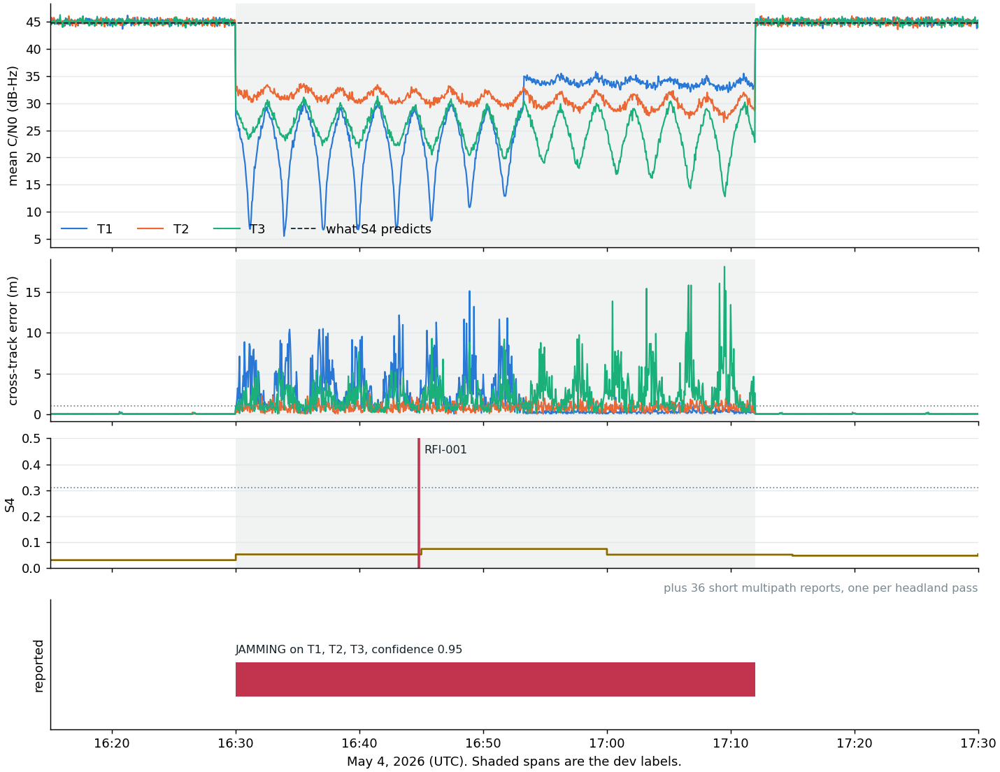

# Straight Rows: why is the tractor drifting?

This project reads 1 Hz telemetry from three tractors, together with Space Domain Awareness feeds, and reports each episode of degraded guidance on the evaluation day: when it started and ended, which machines it affected, what caused it, and what the operator should do. The cause is one of space weather, jamming, spoofing, an equipment fault, or multipath, and causes may overlap. Every report carries a confidence and four sentences of evidence a person can check against the data.

It was built for the Bluestaq and NDSU Straight Rows hackathon. The original starter README is in [docs/starter_README.md](docs/starter_README.md), and the official guide is in [docs/](docs/).

## Setup

Use Python 3.11 to 3.14. Python 3.15 does not work: pandas 2.3.3 has no wheel for it, and the source build crashes when it parses timestamps.

```bash
python3.14 -m venv .venv
source .venv/bin/activate            # Windows PowerShell: .venv\Scripts\Activate.ps1
python -m pip install -r requirements.txt
python scripts/get_data.py           # downloads the dataset into data/ and checks its checksum
```

The dataset is not in the repository. `scripts/get_data.py` fetches the official release; if you already have `StraightRows_Student_Package.zip`, run `python scripts/get_data.py --zip PATH`. Dependencies are pinned in `requirements.txt` (numpy 2.3.3, pandas 2.3.3, matplotlib 3.10.6). No external services, accounts, or credentials are used.

## Regenerate the results

```bash
python make_submission.py
```

This one command scores the detector on the 12 labeled dev episodes, writes `dev_pred.json`, writes `submission.json` for the evaluation window, and checks it with the starter validator.

Other commands:

```bash
python scripts/score_dev.py                       # dev score for this detector
python scripts/score_dev.py --detector baseline   # dev score for the starter baseline
python scripts/sensitivity.py                     # move each threshold by 25% and rerun dev
python scripts/plot_episode.py --start 2026-05-04T16:15:00Z --end 2026-05-04T17:30:00Z --out figures/example.png
python presentation/build.py                      # rebuild the demo page, presentation/index.html
```

## Approach

One table of features at 1 Hz feeds five detectors, one per cause. Each detector reports its own intervals, so a storm and a jammer inside it come back as two overlapping detections. Seconds when a tractor is parked are ignored everywhere.

Three quantities carry most of the work:

- Drop: how many dB a tractor's mean C/N0 sits below its normal level (its median over the file).
- What the sky explains: the drop that the regional S4 scintillation reading predicts. On the dev storm this is `2.1 + 18 × S4` dB once S4 reaches 0.31, and zero below that.
- Unexplained loss: drop minus what the sky explains.



In the figure, the dashed line is what S4 predicts. From 19:00 to 22:00 the tractors follow it, which is space weather. From 20:00 to 20:36 they fall 12 dB below it with S4 unchanged, which is jamming. From 21:30 one tractor drifts off its line while its signal stays on the dashed line, which is spoofing.

The detectors:

- Space weather: every working tractor is at least 5 dB below normal, and S4 over that stretch is at least 0.31.
- Jamming: some working tractor has at least 6 dB of unexplained loss. Tractors with a median of 4.5 dB or more are listed, and two or more make it jamming.
- Spoofing: one tractor's smoothed cross-track error is at least 1 m above the other working tractors, while its unexplained loss stays under 3 dB. The start is walked back by the time the drift took to double.
- Equipment fault: on one tractor, either the weakest satellite keeps dropping 12 dB or more below the mean (an antenna fault), or the RTK correction link drops in repeated short bursts (a link fault).
- Multipath: a 10 to 40 second dip of the weakest satellite at the latitude where that tractor's dips keep recurring. Every pass is reported.

Confidence starts at 0.60. Facts that support the cause add to it, facts that point to a rival cause subtract, and the result stays between 0.05 and 0.95. It is a rule-based score, not a calibrated probability. The four evidence sentences (the farm anomaly, the other machines, the sky feeds, the action) are written from the same measured numbers as the confidence, so the two cannot disagree. All thresholds and weights are in `straightrows/config.py`, each with a comment naming the dev episode it came from.

## How the labeled data was used

The two dev days hold 12 labeled episodes. I plotted each one, recorded which measurements moved and by how much, and set each threshold in a gap those measurements leave open. For example, in the weakest jamming episode one tractor lost 5.5 dB and is in the label, and another lost 2.8 dB and is not, so the cut for "affected" sits at 4.5 dB.

The labels also showed three things that shaped the rules: an episode starts when the tractors start working, even if the signal was already degraded; causes overlap, including two on the same tractor; and jamming inside a storm looks the same on every tractor, so equal loss cannot be the test for space weather.

No threshold was tuned against the evaluation window. [NOTES.md](NOTES.md) lists every threshold with its source.

## Results on the dev episodes

| | Diagnostic | Episodes caught | False positives | Mean onset credit |
|---|---|---|---|---|
| Starter baseline | 20.15 / 40 | 7 of 12 | 5 | 0.497 |
| This detector | 40.00 / 40 | 12 of 12 | 0 | 1.000 |

A full score on dev is expected, because every threshold was chosen on these episodes. It shows the rules agree with the labels. It does not predict the evaluation score. The largest onset errors are 2.8 minutes late (spoofing inside a storm) and 1.5 minutes early (an antenna fault), both inside the scorer's 5-minute grace.



## Failure modes and false alarms

The sensitivity sweep moves each of ten thresholds to 0.75 and 1.25 of its value. Seventeen of the twenty moves change nothing on dev. The three that break something show where the approach is fragile:

- Raising the jamming trigger from 6 to 7.5 dB splits the weakest jamming episode into pieces and adds three false positives.
- Raising the "affected" cut from 4.5 to 5.6 dB drops one tractor from that same episode, and it is missed.
- Lowering the antenna dropout gap from 12 to 9 dB counts storm and jamming noise as dropouts and reports ten false faults.

Failure modes that matter in use:

- A jammer weaker than the weakest one in dev (under 6 dB on its hardest-hit tractor) is not detected.
- The sag model comes from one storm day. If S4 relates to signal loss differently on another day, a storm can be reported as jamming or a jammer hidden inside a storm.
- If S4 arrived one sample late, the first 15 minutes of a storm would look unexplained. When S4 is missing altogether, the detection is still reported, with confidence capped at 0.40 and the evidence saying so.
- One machine losing signal alone is reported as an equipment fault at confidence 0.45 or less. A jammer that reaches only one tractor would be reported the same way. Dev has no such case.
- The spoofing start time assumes a steady drift. A spoofer that jumps the position would get a late start.
- Multipath is located by reported latitude, which is displaced during spoofing.

[NOTES.md](NOTES.md) has the full sweep table, the baseline's misses and false positives with their causes, and the complete list of limits.

## Design decisions

<!-- decisions:start -->

### 1. One detector per cause

Five detectors run independently over the whole file, and each reports its own intervals. A storm and a jammer inside it come back as two overlapping detections.

Rejected:

- One classifier that gives each moment a single cause, as the baseline does. It cannot report TRN-05 or TRN-08, which sit inside a storm.
- Splitting a storm around the event inside it. The scorer matches one detection to one label, so a split storm becomes one match plus extra false positives.

Evidence from dev: Three of the 12 dev episodes overlap another one: TRN-05 and TRN-08 sit inside the TRN-02 storm, and TRN-06 sits inside TRN-09 on the same tractor. The baseline misses TRN-05 and TRN-08 and leaves two fragments behind as false positives.

Limitation: Independent detectors can read one event two ways. A single machine losing signal is the open case: it is reported as a fault, and a jammer beside one tractor would look the same. A second receiver on the machine would separate them.

### 2. Telemetry sets the clock, and only working tractors count

Start and end times come from the 1 Hz telemetry, and every rule ignores the seconds when a tractor is parked.

Rejected:

- Timing from the sky feeds. Kp arrives every 3 hours and S4 every 15 minutes, which is too coarse for the 5-minute onset window.
- Counting parked tractors. The baseline does, and it starts TRN-01 75 minutes early.

Evidence from dev: TRN-01's label starts at 11:00:00, the second the tractors start moving. The sag began at 09:45 while they were parked. With the working mask the detector starts at 11:00:00. The baseline starts at 09:45 and earns no onset credit for that episode.

Limitation: Working is decided by speed above 1 m/s. A tractor that stopped briefly mid-field during an episode would split it. A work-state signal from the implement would be firmer than speed.

### 3. A model of how much loss the sky explains

The signal loss the sky explains is 2.1 + 18 × S4 dB once S4 reaches 0.31, and zero below that. Every other rule measures against it.

Rejected:

- Kp as the storm test. Kp is planet-wide and arrives every 3 hours. On May 5 it read 5.7 from 06:00, while the farm's signal was normal until 09:45 apart from one 15-minute dip.
- Step detection on telemetry alone. A storm changes strength mid-episode (8 dB to 14 dB at 10:00 on May 5), and without S4 that step looks like a new event.

Evidence from dev: Fitted to the May 5 storm: 7.8 dB at S4 0.317, 9.6 at 0.418, 13.8 at 0.648, and 16.4 at 0.795, with residuals under 0.1 dB. S4 between 0.27 and 0.30 produced no sag. In the sensitivity sweep, moving the slope or the threshold by 25% changes nothing on dev.

Limitation: It rests on one storm day in one simulator. If S4 lagged the farm by one 15-minute sample, the start of a storm would look unexplained. A second storm, or S4 at a 1-minute cadence, would test both.

### 4. Jamming is the loss the sky does not explain

Jamming is reported where some working tractor has 6 dB or more of loss beyond the S4 prediction. Tractors whose median unexplained loss is 4.5 dB or more are listed, and two or more make it jamming.

Rejected:

- Unequal loss across tractors as the jamming test. TRN-05 is jamming, and every tractor loses the same 12 dB.
- Kp below 5 as a condition, as in the baseline. It misses any jammer that operates during a storm.

Evidence from dev: TRN-03 leaves 16.5, 14.0, and 19.3 dB unexplained with S4 at 0.05. TRN-05 leaves 12.1, 11.9, and 12.0 dB on top of a 10 dB storm sag. In TRN-04, T1 at 5.5 dB and T3 at 8.0 dB are in the label and T2 at 2.8 dB is not, so the cut sits between 2.8 and 5.5.

Limitation: TRN-04 pins both thresholds. Raising the trigger to 7.5 dB splits it into pieces, and raising the cut to 5.6 dB loses it. A jammer weaker than TRN-04 is missed. Per-satellite C/N0 would show a jammer's direction and allow a lower threshold.

### 5. Kp is context, never a test

Kp never decides a class or a start time. It adds 0.05 to space weather confidence when it reaches 5, and the evidence quotes it as global context.

Rejected:

- Kp as a gate, as in the baseline: at or above 5 for space weather, below 5 for jamming.

Evidence from dev: On May 5, Kp fell from 9.0 to 3.0 at 15:00 while the storm at the farm ran until 16:00, and from 6.8 to 3.0 at 21:00 while it ran until 22:00. The baseline relabels both final hours as jamming, which accounts for two of its five false positives.

Limitation: Ignoring Kp gives up early warning. Kp rose at 06:00 on May 5, hours before the main impact at the farm. A forecast product would be the right use for it.

### 6. An interference report supports jamming, and a missing one says nothing

A report that arrives within 45 minutes after the start, with the farm inside its semi-major radius, adds 0.15 to jamming confidence, or 0.05 if the report's own confidence is under 0.5. A missing report subtracts nothing. Reports never set a start time.

Rejected:

- Requiring a report before calling jamming. TRN-05 has none.
- Using the report time as the start. Reports arrive 10 to 30 minutes late.

Evidence from dev: RFI-001 arrived 14.8 minutes after TRN-03 began, 0.71 km from the farm. RFI-002 arrived 10.7 minutes after TRN-04, 1.04 km away. TRN-05 has no report. RFI-004 (confidence 0.35, issued while the tractors were parked, 4.8 km away) matches no detection.

Limitation: The reports give an ellipse without an orientation, so the test uses the semi-major length and can accept a report whose ellipse points away from the farm. An orientation or a bearing would fix that.

### 7. Spoofing is a drift on one tractor with a healthy signal

Spoofing is one tractor whose smoothed cross-track error is 1 m or more above the other working tractors while its unexplained signal loss stays under 3 dB. The start is walked back by the time the drift took to double.

Rejected:

- A fixed cross-track limit. In a storm every tractor spikes past 1 m.
- Requiring normal signal strength, as the baseline does. It misses TRN-08, where a storm has lowered the signal on every machine.
- The threshold crossing as the start. It comes 4 to 11 minutes after the label's start.

Evidence from dev: The starts found are 3 s, 1 s, and 170 s from the labels for TRN-06, TRN-07, and TRN-08. The drifts climb at 0.14, 0.24, and 0.12 m per minute. In TRN-03, T1 also wanders, but its unexplained loss is 16.5 dB, so it is not called spoofing.

Limitation: The walk-back assumes a steady drift. A spoofer that jumps the position, or drifts and pauses, would get a late start. Cross-track error here comes from an idealized monitor. A real receiver would need wheel odometry or an IMU to see the drift at all.

### 8. Faults show in dropout rate and link flaps, not in average signal

An antenna fault is one tractor whose weakest satellite sits 12 dB or more below its mean signal for at least 12% of a 10-minute window. A link fault is the correction link dropping in bursts less than 5 minutes apart for at least 5 minutes.

Rejected:

- Mean signal strength as the fault signal. In TRN-09 the mean holds at 44.8 dB-Hz.
- Link down for three minutes straight, as in the baseline. In TRN-10 the longest burst is 16 seconds.

Evidence from dev: In TRN-09, T2 has dropouts 24% of the time against 3% on the other tractors. In TRN-10, T1's link is down 30% of the time while its signal stays at 45.0 dB-Hz. The starts found are 90 s early and 1 s late.

Limitation: Lowering the dropout gap to 9 dB counts storm and jamming noise as dropouts and produces ten false faults on dev. Per-satellite C/N0 would show whether one satellite or one side of the antenna is failing.

### 9. Multipath is a dip that recurs at one place, reported on every pass

Multipath is a 10 to 40 second dip of the weakest satellite, 9 dB or more below the mean, at the latitude where a tractor's dips keep recurring. Every pass is reported as its own short detection.

Rejected:

- Reporting one representative dip. Only one pass is scored, and dev gives no way to tell which.
- Reporting dips anywhere in the field. On the two dev days about 555 short dips fall away from the headland.

Evidence from dev: On the two dev days each tractor dips at latitude 46.907 about 324 times, once every 356 seconds while working. Both dev labels are found, one to the second and one a second early. The dips elsewhere in the field are not reported.

Limitation: The submission carries about 486 multipath reports, close to the validator's limit of 500. Location uses the reported latitude, which is displaced during spoofing. A site survey naming the obstruction would replace the inference.

### 10. Confidence and evidence come from the same numbers

Each detector records what it measured. Confidence is 0.60 plus or minus fixed weights for those facts, kept between 0.05 and 0.95, and the four evidence sentences are written from the same numbers.

Rejected:

- One confidence value for every detection. The baseline uses 0.5.
- A statistical model of confidence. Twelve episodes cannot fit one or check one.

Evidence from dev: Dev confidences run from 0.50 for TRN-05 (equal loss inside a storm, no report) to 0.95 for TRN-03 (graded loss, a report, a quiet sky). Because both outputs read one set of facts, the text cannot contradict the number.

Limitation: The weights are judgment. Whether 0.8 means right 80% of the time is unknown. More labeled episodes would allow a calibration check.

### 11. One machine losing signal is reported as a fault

If only one working tractor has unexplained signal loss, it is reported as an equipment fault with confidence capped at 0.45, and the evidence names a nearby jammer as the alternative.

Rejected:

- Calling it jamming. One machine cannot show the footprint across machines that a transmitter leaves.
- Reporting nothing. A machine with 6 dB or more of unexplained loss should be looked at.

Evidence from dev: Dev has no such case, so this rule rests on reasoning. Both readings lead to stopping that one machine.

Limitation: It is untested on labeled data. A jammer that reaches only one tractor on evaluation day will be reported as a fault. Per-satellite C/N0 or a second antenna would separate the two.

### 12. Thresholds are frozen on dev, and evaluation is run once

Every threshold was set on the two dev days. The configuration is frozen in a commit before the evaluation output is looked at, and nothing learned from that output changes it.

Rejected:

- Adjusting thresholds after looking at evaluation detections. With no labels there, any adjustment is a guess that happens to look good.

Evidence from dev: The dev score is 40.00 of 40 against the baseline's 20.15, which is expected because the thresholds were chosen there. The sensitivity sweep moves each threshold by 25%, and 17 of 20 moves change nothing.

Limitation: A full dev score says nothing about evaluation day. The sweep and the stated limits are the measure of how far the result can be trusted.

<!-- decisions:end -->

## Additional data that would improve attribution

- Per-satellite C/N0. A jammer has a direction and an antenna fault has a pattern across satellites; the mean and the minimum hide both.
- An IMU or wheel odometry on each tractor. Cross-track error here comes from an idealized monitor. A real receiver cannot see its own spoofed drift without an independent position source.
- Orientation or bearing for the interference reports. The reports give an ellipse without a direction, so a report can only be matched by distance.
- S4 at a finer cadence, and a second storm. Both would test the sag model and the assumption that S4 and the farm impact move together.
- More labeled episodes, especially weak jamming and single-machine signal loss. Those are the cases the thresholds cannot currently separate.
- A work-state signal from the implement, which would be firmer than speed for deciding when a tractor is working.
- A site survey of the headland, to name the obstruction behind the recurring multipath.

## Repository layout

| Path | Contents |
|---|---|
| `straightrows/` | The detector: `config.py` (thresholds), `data.py`, `features.py`, `intervals.py`, `detectors.py`, `evidence.py`, `pipeline.py` |
| `make_submission.py` | Regenerates `dev_pred.json` and `submission.json` |
| `decisions.json` | The design decisions, rendered into this README by `scripts/render_decisions.py --write` |
| `NOTES.md` | Threshold sources, dev results, the sensitivity sweep, known limits |
| `scripts/` | Data download, dev scoring, the organizers' scorer, the sensitivity sweep, plotting |
| `figures/` | Figures used in this README |
| `presentation/` | A demo page that draws the solution's outputs. It is a viewer and not part of the detector |
| `submission/`, `notebooks/`, `docs/` | The starter baseline, validator, notebook, and official guide, unchanged |
